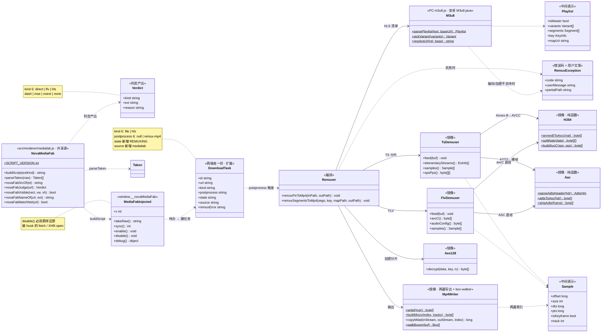
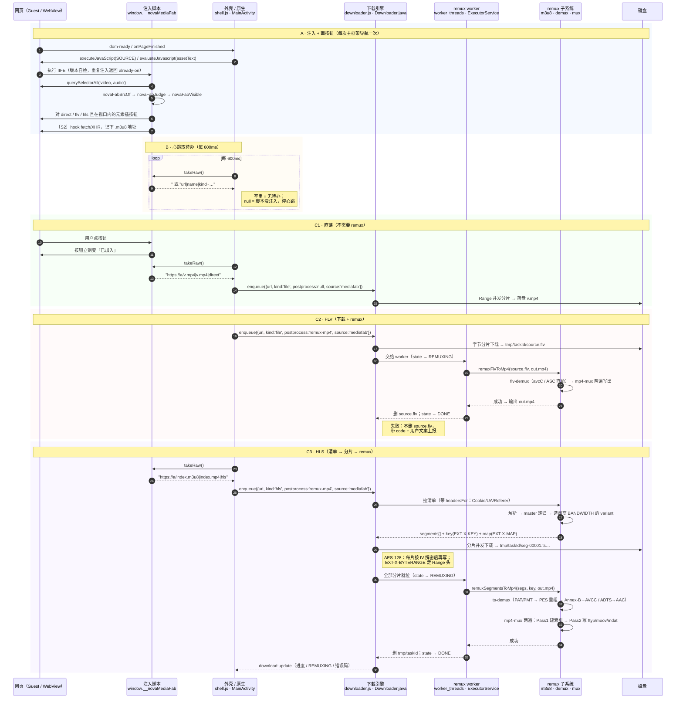
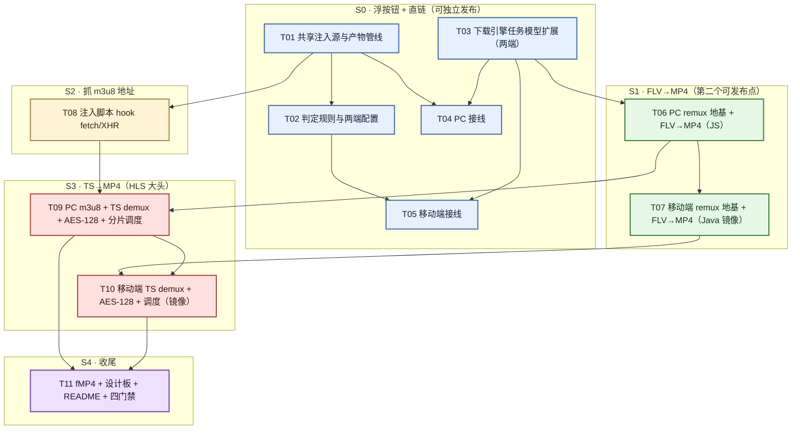

# 媒体悬浮下载 + 自研 remux 到 MP4 · 系统设计与任务分解

> 版本：**v2（按最终需求重做，v1 部分内容作废）** · 架构：高见远
> 最终需求：页面里的视频 / 音频旁边浮一个下载按钮，点了之后**在下载那一刻**去拉数据；`.mp4` 等直链直接存，`.flv` 与 `.m3u8` 用**自研 remux 合成 mp4**（只支持 H.264 + AAC 源）；MSE（`blob:`）**不浮按钮、如实不做**。
> 范围：**移动端 + PC 端一起做**，只覆盖视频 + 音频，不含图片。

## v1 → v2 变更总览

| # | v1 的结论 | v2 的处置 | 为什么 |
|---|---|---|---|
| 1 | 「m3u8 / blob 一律不浮按钮」 | **作废**。改为 `m3u8` **浮**、`blob:` 仍不浮 | 用户要求「m3u8 及 flv 转 mp4」，m3u8 正是要覆盖的场景 |
| 2 | 「明确非目标：把分片下下来再合并」 | **部分作废**。HLS 分片合并进入范围；MSE（`blob:`）仍在范围外 | 同上 |
| 3 | 「点了直接进下载器」 | **作废**。改为三类分流：直链 → 下载器；flv → 下载器 + 后处理 remux；m3u8 → 分片调度 + remux | 需求主干 |
| 4 | 假设 A2「安卓没有按标签页聚合的媒体清单」是选型的关键约束 | **该约束消失**。因为数据来源是 DOM 元素的 `src`，不是网络层嗅探记录 | 「点才拉」这条设计使嗅探清单不再必要。**好消息：两端能力对称，不用给安卓补嗅探清单** |
| 5 | 无 remux 能力 | **新增整个 remux 子系统**（见 §2），是本轮最大的工作量 | 用户明确要自研、不引依赖 |
| 6 | 源码一份 / 两端逐字节相同 / DOM 注入按钮 / 拒绝原生浮层 / 三条触发源 / sync 产物管线 / `autoDownload` 处置 / 待办串格式 | **全部保留** | 这些结论与需求变更无关 |
| 7 | — | **新增**：PC 端 remux 必须放 `worker_threads`；remux 必须两遍扫描、不全量缓冲 | 否则阻塞 Electron 主进程 / 被 2GB 文件搞崩 |

## ⚠️ 动手前必须先确认的事实（其中两个可能改变结论）

### 事实 1：**桌面端浏览器内几乎覆盖不到任何 HLS 站点**（影响最大）

桌面 Chromium **不支持原生 HLS 播放**。所以任何要在桌面浏览器播 HLS 的站点，都必然用 hls.js / video.js 这类 JS 播放器，而它们会把 `<video>` 的 `src` 设成 `blob:`（MSE）。Android WebView 同样不支持原生 HLS。也就是说：

> **只要站点用了 hls.js，`<video>` 的 `src` 就是 `blob:`，按「MSE 不浮」的规则，按钮不会出现，m3u8 remux 这条路就没有对象可下。**

所以 `m3u8 → mp4` 要真正有用，**必须**再加一步：**在页面里 hook `fetch` / `XMLHttpRequest`，把 hls.js 请求的那个 `.m3u8` 地址抓下来**（见 §5 S2 / 任务 T08）。

| 情形 | `<video src>` | 能否覆盖 |
|---|---|---|
| 站点给原生 HLS 直链（部分移动端 / 部分站） | `https://…/index.m3u8` | ✅ 浮按钮，走 m3u8 remux |
| 站点用 hls.js / video.js（**桌面端绝大多数**） | `blob:https://…/uuid` | ⚠️ **必须先做 T08 抓 URL**，否则不覆盖 |
| 站点用原生 `<video src="…mp4">` | `https://…/v.mp4` | ✅ 直链下载 |
| B站 / YouTube / 腾讯 / 爱奇艺主路径（MSE + 自有 CDN） | `blob:` | ❌ 用户已确认不覆盖 |

**这是本轮最重要的一个 scope 决策，需要拍板**：要不要做 T08（页面内 hook fetch/XHR）？不做的话，m3u8 的 remux 工作量（§3 里 S3 那 2400–4000 行）实际产出接近于零。我的建议是**做**（理由与风险见 §5 S2）。

### 事实 2：HLS 常常是加密的，**AES-128 必须做**

README 第 745 行已经把这条边界写下来了：「加密的 HLS（`#EXT-X-KEY`）：分片能嗅到，但单独下下来也解不开」。真实站点里 `#EXT-X-KEY:METHOD=AES-128`（Apple 规范允许、很多站默认开）占比不低。

**建议：加做 AES-128 解密。** 理由：

- **零新增依赖** —— Node 有内置 `crypto`（`createDecipheriv('aes-128-cbc')`），Java 有内置 `javax.crypto.Cipher`。各约 40–70 行。
- 不做的话，很大一部分 HLS 站点会下回来一堆解不开的字节，用户会觉得「m3u8 支持是假的」。
- 只支持 `METHOD=AES-128`。`SAMPLE-AES` / `SAMPLE-AES-CTR` / DRM 一律给诚实拒绝（`E_ENCRYPTED_UNSUPPORTED`）。
- IV 规则：`#EXT-X-KEY` 里给了 `IV` 就用；没给则**用分片序号当 IV**（HLS 规范默认行为）。
- key 按 `URI` 拉一次并缓存（同一份清单里所有分片共用一把 key）。

**这是一个 scope 增加，需要确认。** 我认为成本（两端合计 ~120 行）远低于收益。

### 事实 3：项目里没有可复用的原生层

`native/` 下只有 vendored 的 CEF 源码树（引擎构建用），**没有应用级 JNI 模块**。全仓库搜不到 ffmpeg / remuxer / muxer / demuxer / avcC / ADTS 的任何实现。所以 remux 只能从零写，两端各一份 —— 见 §2 的选型论证。

---

# Part A · 系统设计

## 1. 整体架构

在 v1 的基础上**串上一段 remux 管线**。分层如下：

```
┌────────────────────────────────────────────────────────────────────────┐
│ 第 1 层 · 注入页面的脚本（源码一份，两端逐字节相同）                    │
│   src/renderer/mediafab.js  ──sync──▶  PC 产物 + 安卓 assets 产物      │
│   职责：找 video/audio → 解地址 → 判定三类 → 画按钮 → 收点击进待办     │
│   〔S2 追加〕hook fetch/XHR 抓 m3u8 / mpd 地址（hls.js 站点用）         │
└────────────────────────────────────────────────────────────────────────┘
                                  │ 每 600ms 拉一次待办（~ 分隔串）
                                  ▼
┌────────────────────────────────────────────────────────────────────────┐
│ 第 2 层 · 外壳 / 原生（两端各一份，逻辑薄）                            │
│   PC: shell.js        ·  安卓: MainActivity                            │
│   源码一份：解析待办 → 按 kind 分派 → 建下载任务                        │
└────────────────────────────────────────────────────────────────────────┘
                                  │ 建任务
                                  ▼
┌────────────────────────────────────────────────────────────────────────┐
│ 第 3 层 · 下载引擎（两端各一份，复用现有实现 + 扩展）                  │
│   PC: src/main/downloader.js      安卓: Downloader.java                │
│   任务新增两个正交维度：                                                │
│     kind       : 'file'（一个 URL 按字节分片） | 'hls'（分片清单调度）   │
│     postprocess: null | 'remux-mp4'                                    │
│   新增状态 REMUXING；临时目录用 cacheDir / temp（不占用户存储）        │
└────────────────────────────────────────────────────────────────────────┘
                                  │
                                  ▼
┌────────────────────────────────────────────────────────────────────────┐
│ 第 4 层 · remux 子系统（两端各一份，**纯二进制、零框架依赖**）         │
│   PC: src/main/remux/*.js（跑在 worker_threads）                        │
│   安卓: top.wuai.nova.remux/*.java（跑在后台线程）                      │
│   m3u8 解析 · TS demux · FLV demux · H.264 Annex-B→AVCC ·              │
│   AAC ADTS→ASC · AES-128 解密 · MP4 muxer                              │
└────────────────────────────────────────────────────────────────────────┘
```

**一个贯穿全局的原则**（要写进 README 与代码注释）：

> **remux 是「搬运 + 建索引」，不是「解码 + 编码」。** 我们把 H.264 的 NAL 单元和 AAC 的裸帧**原样搬**进 MP4 的 `mdat`，只在外面套一层 MP4 的容器与索引表。所以：测试向量可以是**合成的最小合法样本**（不需要真实的音视频内容）；风险集中在「索引表算对没有」，而不是「画质」。

---

## 2. remux 的代码放哪儿（本轮核心架构分歧点）

### 选型：**两端各写一份实现（PC 用 JS、Android 用 Java），用同一组测试向量钉住**

| 候选 | 结论 | 代价 / 理由 |
|---|---|---|
| **1. 两端各写一份** | ✅ **选它** | 唯一可行。代价是 ~5300–8000 行（见 §3），但结构可以做成**逐函数镜像**，且两端的 remux 都是**纯二进制、零框架依赖**，可离线单测 |
| 2. 移动端用 WebView 跑同一段 JS | ❌ **不可行**（不是"代价大"，是走不通） | 见下四条硬阻塞 |
| 3. 引入嵌入式 JS 引擎（QuickJS / Rhino） | ❌ **自相矛盾** | 用户拒 ffmpeg 的理由是 APK 体积（现 384KB）。Rhino 是 ~1.5MB jar，且**解释执行**跑字节级循环比 Java 慢 10–50 倍（30 秒的 remux 变成 10 分钟以上，还费电）；QuickJS 需要按 ABI 编 `.so`（arm64/armv7/x86/x86_64 合计 4–6MB）+ NDK 工具链。**若因体积拒绝 ffmpeg，就不能接受 QuickJS** |

### 为什么方案 2 走不通（四条硬阻塞，逐条说明）

1. **输出无处可去。** `evaluateJavascript` 的返回值会被 **JSON 编码成字符串**；一个 500MB 的 MP4 根本跨不过这条边界（字符串长度上限 + 内存翻倍）。而 WebView 里的 JS **没有任何途径写入 App 的 `filesDir`** —— OPFS（Origin Private File System）确实能写，但它是 WebView 的存储沙箱，Java 侧读不到、也拿不出来。
2. **输入要跨边界搬几百 MB。** 300 个分片 × 300KB = 90MB。推进 WebView 要么走 base64（膨胀 33%，约 120MB 的字符串），要么走 `@JavascriptInterface` 返回 `byte[]`（可行，但要整份驻留 WebView 堆 —— 低端机直接 OOM）。
3. **会 ANR。** WebView 的 JS 跑在页面主线程上；一次 30 秒的 remux 会把页面渲染冻住。Android 也会因主线程阻塞报 ANR。
4. **没有后台线程可用。** 下载的后处理必须在后台线程（Android 强制要求）；WebView 的 JS 没有后台线程这个概念。

### 两端各写一份，如何保证不「慢慢长歪」

**必须逐字节一致的**：**给定同一条输入，产出的 MP4 文件本身**（sha256 必须相同），以及中间产物的关键结构（demux 出的样本序列：`(offset, size, dts, pts, isKeyframe)` 逐条相同）。

**不必一致的**：内部数据结构、日志文案、错误文案、临时文件命名。

**三条保证机制**：

| 机制 | 做法 |
|---|---|
| **① 输出必须字节确定（设计硬约束）** | muxer **不许**用墙钟时间、不许用随机数、不许依赖 `Map` 的遍历顺序。所有 box 顺序、字段值都必须由输入唯一决定。**这条是能做跨语言断言的前提**。要写进 `mp4-mux.js` / `Mp4Writer.java` 的类注释 |
| **② 结构做成逐函数镜像** | Java 侧的函数分解与命名**照抄** JS 侧（`readUInt32` / `tsFindPmt` / `flvReadTag` / `mp4WriteStsz`…）。镜像结构下翻译是机械的、可逐行 review |
| **③ 共享测试向量清单** | 一份 `tools/remux-vectors/vectors.json`（+ 二进制输入样本），Node 的 `tools/test-remux.js` 与 JUnit 的 `RemuxVectorsTest.java` **读同一份清单**，断言同样的 sha256 与同样的结构性断言。这是工程里已有的先例（跨语言只约定格式、两端同一组测试数据） |

**向量的权威从哪来？（避免循环论证）**

不能「两端互相验证」——那只是互相背书。真正的裁判在工程之外：**生成的文件能不能播**。

- 流程：**PC 端实现先行** → 用手工合成的最小样本跑出 MP4 → **在 VLC / ffplay 里实际播放确认能播**（这是外部权威）→ 冻结 sha256 进 `vectors.json` → 安卓端实现必须匹配。
- 发现分歧时的裁决：先怀疑**安卓端**（PC 端是先行实现，且在 Node 里能逐字节调试，验证成本低得多）。若两端都与向量不符 → 是向量错了，需要人工重新用播放器核一遍并更新向量。**绝不允许「把两端都改成一样」来让测试通过。**

---

## 3. remux 工作量评估（诚实的数字）

这是本轮、也是这个工程迄今为止最大的单块工作。

| 模块 | PC/JS 行数（含注释） | 安卓/Java 行数 | 难点在哪 |
|---|---|---|---|
| **m3u8 解析**（master/media、`EXT-X-KEY`、`EXT-X-MAP`、`EXT-X-BYTERANGE`、`EXT-X-DISCONTINUITY`、绝对/相对 URL） | 250–350 | 300–420 | 纯文本，好测。难在 master 的递归与 variant 选择 |
| **TS demux**（188 包同步、PAT/PMT、PES 跨包重组、PTS/DTS 33 位回绕、stream_type 识别） | 700–1000 | 850–1250 | **最难**。PES 头可能跨包、时间戳回绕、乱序包、填充包 |
| **H.264 处理**（Annex-B → AVCC、提取 SPS/PPS、拼 avcC、AUD/IDR 处理） | 250–380 | 300–450 | SPS/PPS 可能**带内重复出现**或只在带外（PMT 的 descriptor）——两种都要认 |
| **AAC 处理**（ADTS 头解析、抽裸帧、ADTS→AudioSpecificConfig） | 120–200 | 150–250 | ADTS 头 7/9 字节两种；要区分 AAC-LC / HE-AAC |
| **FLV demux**（FLV 头、Tag 循环、AVC/AAC sequence header → avcC / ASC、NALU / raw 载荷） | 250–400 | 300–480 | **最省的一档**：AVCC 与 ASC 是 sequence header **直接给的**，不需要解 Annex-B / ADTS |
| **MP4 muxer**（ftyp / moov / mdat；stsd(avc1+avcC, mp4a+esds)、stts、stss、stsc、stsz、stco/co64、ctts） | 450–700 | 550–850 | 索引表算错 = 花屏 / 音画不同步 / 播放器直接拒开。B 帧要 `ctts` |
| **AES-128 解密** | 40–70 | 50–90 | 两端都有内置 AES-CBC |
| **编解码识别 + 诚实拒绝** | 80–120 | 100–150 | 简单但必须做（否则静默给出打不开的文件） |
| **HLS 分片调度**（并发下载、顺序拼接、进度、失败重试、临时文件） | 250–400 | 300–480 | 接到现有下载引擎上 |
| **总计** | **2390–3620** | **2900–4420** | |
| | | | **两端合计约 5300–8000 行** |

再加测试：`test-remux.js` + `RemuxVectorsTest.java` ≈ **1500–2000 行**（不含手工合成样本的生成脚本）。

**参照系**（让这个数字有感觉）：现有 `sniffer.js` 686 行、PC `downloader.js` ~1400 行、安卓 `Downloader.java` ~900 行。**remux 这一块比工程里现有任何一个模块都大 3–5 倍。**

### 分阶段方案（按「每阶段都能交付一个能播的文件」切）

| 阶段 | 内容 | 两端新增行数 | 覆盖什么 | 为什么这个顺序 |
|---|---|---|---|---|
| **S0** | 浮按钮 + 直链交给下载器（**不含 remux**） | ~700 | 所有 `<video src="*.mp4/.webm/.mkv/.mov">` 的站点：小站、论坛、直链网盘、社交平台视频、播客 | 先让主体链路通、能发布。**用户立刻能感受到价值，且零 remux 风险** |
| **S1** | **FLV → MP4** | ~1500–2400 | 国内 CDN 的 `.flv` 直链、直播回放 | **最省的一档**：AVCC / AudioSpecificConfig 由 sequence header 直接给；同时把 **MP4 muxer 建好**（S3 的公共前置） |
| **S2** | **页面内 hook fetch/XHR 抓 `m3u8` / `mpd` 地址** | ~400–600 | 解锁所有 hls.js 站点 —— **不做这一步，S3/S4 无对象可下** | 纯注入 JS 的事，与 remux 无关，**应该排在 S3 之前** |
| **S3** | **TS → MP4**（+ AES-128 + HLS 分片调度） | ~2400–4000 | **老式 HLS（`.ts` 分片）—— HLS 的真正大头** | 最难。PES 重组 + Annex-B→AVCC + ADTS→AAC。**不做 S3，m3u8 支持基本是空谈** |
| **S4** | **fMP4（`.m4s`）→ MP4** | ~600–1000 | 新式 HLS（fMP4 分片） | **最便宜的收尾**：init 段自带 `moov`，不需要写 muxer，只需拼装 + 修 `trun` 的 data offset |
| **S5** | DASH（`.mpd`） | ~1400–2200 | DASH 站点 | **建议本轮不做**。`SegmentTemplate` 的变量替换 + 多轨（视频/音频分离）是另一套体系。S2 抓到的 `.mpd` 只用来**给用户一句诚实提示**，不实现下载 |

**如果预算不够，建议的止损线**：

- **S0 + S1** = 可交付的最小闭环（直链 + FLV 两个用户能感知的能力），~2200–3100 行
- **+ S2** = 解锁 HLS 的可能性，但**此时还没有 TS demux，仍然下不了任何东西** → 所以 **S2 与 S3 必须一起交付，单独做 S2 没有任何用户价值**
- **+ S3** = 才真正覆盖 HLS，但这一步就占了总工作量的一半

**必须写进 README 与汇报的一句话**：即使做完 S0–S4，**B站 / YouTube / 腾讯 / 爱奇艺 仍然一个都不覆盖**（主路径全是 MSE + DRM）。这个功能最终覆盖的是「**中小视频站 + 直播回放 + 直链网盘 + 播客 + 社交平台视频**」，不是「主流视频平台」。

---

## 4. 浮出规则（v1 这一节作废，重写）

### 4.1 三类分流

| 资源（DOM 解出的地址） | 浮按钮 | 点了之后 |
|---|---|---|
| `*.mp4` / `*.webm` / `*.mkv` / `*.mov` / `*.m4v` 等直链 | ✅ | 交给内置多线程下载器，**不 remux** |
| `*.flv` | ✅ | 下载器下到临时文件 → **remux 成 mp4** → 成功则删临时、失败则保留原 flv 并给提示 |
| `*.m3u8`（含 hls.js 站点经 T08 抓到的地址） | ✅ | 解析清单（master 递归）→ 分片并发下载到临时目录 → demux + remux 成 mp4 → 删临时分片 |
| `*.mpd`（DASH） | ✅（仅 S2 抓到时） | **不实现下载**，给一句诚实的「暂不支持 DASH」提示 |
| `blob:` / `mediasource:`（MSE） | ❌ | 什么都不做，安静 |
| `data:` | ❌ | 同上 |
| 无扩展名的 `/api/media?id=1` | ❌ | 同上（浮层手上只有 URL 没有响应头，猜了就可能给出点了下不来的按钮） |
| 其它（图片、文档、压缩包…） | ❌ | 同上（只覆盖视频 + 音频） |

### 4.2 HLS 的 master playlist 怎么选路

- **选 `BANDWIDTH` 最高的那一路**。理由：下载器不是播放器，不需要自适应码率；用户点「下载」的意图是「拿到最好的那份」。
- **否决「选第一个」**：清单里第一个常常是**最低码率**（很多服务端按升序写，作为 ABR 的起点），选它用户会觉得画质差。
- **否决「弹框让用户挑」**：本轮不引额外交互；且绝大多数站点只有一个 variant。
- 带 `RESOLUTION` 时把它显示在按钮的提示里（「已选 1080p」）。
- **取不到 `BANDWIDTH` 时回落到第一个 variant**，并在界面上如实标注「未标注码率，取了清单里第一条」。
- 只有一层 master → 直接是 media playlist，跳过选择。
- 是否让用户手选码率 → 放进「待拍板」。

### 4.3 「点了之后才发现不行」的诚实反馈

设计一套**错误码 + 用户可读文案**。呈现位置：下载面板的条目副标题 + 一次 toast。

| 错误码 | 触发条件 | 用户看到的（一句话：发生了什么 + 你能怎么办） |
|---|---|---|
| `E_CODEC_UNSUPPORTED` | 源不是 H.264 或 AAC（TS 的 `stream_type` 不是 `0x1B`/`0x0F`；FLV 的 `codecID` 不是 7 / `soundFormat` 不是 10） | 「这段视频用的是 XXX 编码，本机不带转码器，无法存成 mp4」+ **保留已下载的原始文件** |
| `E_ENCRYPTED_UNSUPPORTED` | `#EXT-X-KEY` 的 METHOD 不是 `NONE` / `AES-128`（即 SAMPLE-AES / DRM） | 「这段视频有内容保护，无法保存」 |
| `E_DRM` | 出现 `#EXT-X-SESSION-KEY` / PSSH box | 同上 |
| `E_PLAYLIST_EMPTY` / `E_PLAYLIST_PARSE` | master 里没有可用 variant / 清单格式坏了 | 「没能读到这段视频的分片列表」 |
| `E_SEGMENT_INCOMPLETE` | 分片下载缺片、数量对不上 | 「分片没下全（下到 N/M），原始分片已保留」+ 允许重试 |
| `E_REMUX_FAILED` | demux / mux 抛错 | 「合并失败」+ 保留原始文件 |
| `E_TOO_LARGE` | 输出预计超过 4GB（MP4 的 32 位 box 上限，除非走 co64） | 「文件太大，超出 mp4 单文件上限」 |

**三条必须遵守的原则**（写进注释 + README）：

1. **失败不删原始数据。** remux 失败时把已下载的分片 / flv 保留下来，并给一个「打开所在文件夹」的入口。删了用户就真的什么都没有了。
2. **绝不静默降级。** 绝不把 remux 失败的文件换个 `.mp4` 后缀交给用户。
3. **失败文案里不出现「ffmpeg」「demuxer」「muxer」「PES」「stts」。** 用户看不懂；也不给误导性的「请重试」（编码不支持，重试一万次都一样）。

---

## 5. 各阶段技术要点

### S0 · 浮按钮 + 直链下载

与 v1 相同，只有判定规则换成了 §4.1 那张表。以下 v1 结论原样保留：

- **注入脚本遍历 `document.querySelectorAll('video, audio')`**，地址顺序 `currentSrc` → `src` 属性 → 第一个 `<source src>`
- **页面内注入 DOM 按钮**（否决原生浮层：坐标同步是长期维护债，且两端各写一份）
- **CSP 管不到我们**（走 `executeJavaScript` / `evaluateJavascript` 注入，不是页面里的 `<script>` 标签）
- **全内联 cssText，不带类名，`z-index: 2147483647`**，不用 Shadow DOM
- **`position:absolute` 挂 `document.body`，用文档坐标** —— 滚动零抖动
- **三条触发源汇进同一个节流过的 `sync()`**：`MutationObserver`（含 `attributes:['src']`）+ capture 阶段的 `scroll`/`resize`（100ms 节流）+ `setInterval(500)` 兜底
- 出现条件：判定通过 + 宽高都 ≥ 32px + 在视口内 + 本页按钮数 < 20
- 源码一份，`mobile:sync` 生成两个产物，两端注入**逐字节相同**的脚本；PC 端也用生成物（UMD 把脚本字符串放在 `NovaMediaFab.SOURCE`），加断言钉住一致性
- 待办串格式：`url|name|kind` 用 `~` 分隔；URL 里的 `~` → `%7E`；`name` 里的 `~`/`|` → `-`；字段数 < 3 的条目丢弃

**S0 新增的 `kind` 取值**（用于第 2 层分派）：

```
'direct'  → kind:'file',  postprocess:null
'flv'     → kind:'file',  postprocess:'remux-mp4'
'hls'     → kind:'hls',   postprocess:'remux-mp4'
'dash'    → 不进下载器，直接给「暂不支持 DASH」提示
```

### S1 · FLV → MP4

1. 走现有下载引擎把 flv 下到 `<临时目录>/<taskId>/source.flv`
2. `flv-demux` 顺序读：
   - FLV header（9 字节）+ `PreviousTagSize`
   - Tag 循环：type 8（audio）/ 9（video）/ 18（script，跳过）
   - **video tag**：`frameType`/`codecID`（要 7 = AVC）、`AVCPacketType`（0 = sequence header→**直接就是 `AVCDecoderConfigurationRecord`，即 avcC**；1 = NALU，**已经是 AVCC 长度前缀格式**）、`CompositionTime`（→ `ctts` 的 offset）
   - **audio tag**：`soundFormat`（要 10 = AAC）、`AACPacketType`（0 = sequence header→**直接就是 `AudioSpecificConfig`**；1 = raw AAC）
   - 时间戳：FLV 的 tag 时间戳单位就是毫秒，**不需要像 TS 那样做 PTS 归一化**
3. `mp4-mux` 两遍写出（见 S3 的写法说明，两处共用同一个 muxer）
4. 成功 → 删 `source.flv`；失败 → 保留，按 §4.3 给提示

**为什么先做这一档**：FLV 的 `avcC` 与 `AudioSpecificConfig` 是**直接给的**，不需要解 Annex-B / ADTS —— 这是整个 remux 里唯一不用写码流解析器的一档。同时 muxer 被建起来了，S3 只要补 demux 侧。

**诚实提示**：老 FLV 常见 `codecID=2`（H.263 Sorenson）/ `soundFormat=2`（MP3）→ `E_CODEC_UNSUPPORTED`，保留原 flv。

### S2 · 页面内抓 m3u8 / mpd 地址

在注入脚本里加一个**极轻量的页面内网络记录器**：

- hook `XMLHttpRequest.prototype.open` 与 `window.fetch`（**原型方法，后注入也能拦住之后的所有调用** —— 这点很关键，因为 hls.js 早就注册好了，但我们不需要赶在它之前）
- 只记录 URL 的**后缀**在 `{m3u8, mpd}` 里的请求，最多留 8 条（LRU）
- **不记录响应体、不改写请求、不阻塞** —— 只是把 URL 抄下来
- `disable()` / 页面卸载时**原样还原**两个原型方法

**怎么把抓到的 URL 和 `<video>` 元素关联**（这是最脆弱的一环，必须如实说明）：

- hls.js 的 m3u8 请求与 DOM 元素之间**没有任何直接绑定**，只能靠启发式。
- 规则：**页面上有 `<video>` 且它的 `src` 是 `blob:`，同时本页抓到过 m3u8 → 把那个 m3u8 绑到「尺寸最大的那个 video 元素」**。
- 一个页面通常只有一个主播放器，这条规则在实践中命中率不低；多播放器页面会绑错。
- **缓解措施**：按钮的 `title` / 长按提示里**写明将要下载的地址**，让用户点之前能看到；再给按钮加一个小角标（如「HLS」）与直链按钮区分。

**必须一起评估的风险**：
- hook 原型方法有副作用风险（可能与页面代码冲突）；必须在 `disable()` 里严格还原。
- 关联靠启发式，会绑错；绑错的后果是**下载了另一个视频**，比下载失败更难被用户察觉。→ 所以那条「写明将要下载的地址」不是可选项，是必须的。

### S3 · TS → MP4（最难，也是 HLS 的真正大头）

1. **拉清单**：主进程 / 原生侧用 `headersFor(url, engineId)` 带上 Cookie / UA / Referer 去取 m3u8（这一步必须在带登录态的 session 里做，否则很多站点 403）
2. **解析**：master → 选最高 `BANDWIDTH` 的 variant → media playlist
3. **分片调度**：N 个分片并发下载（复用下载引擎的并发池），**顺序拼接**到一个临时文件
   - 必须处理 `EXT-X-BYTERANGE`（同一文件里的字节段，加 `Range` 头）
   - 必须处理 `EXT-X-DISCONTINUITY`（时间戳重置，demux 时以此重置基准）
   - **AES-128**：每片拿 `IV`（给了用给的，没给用分片序号）解密后再拼
4. **TS demux**：
   - 188 字节包同步（`0x47`）+ PID 解复用
   - PAT（PID 0）→ PMT PID；PMT → 各基本流的 PID 与 `stream_type`（`0x1B` = H.264、`0x0F` = AAC-ADTS、`0x03`/`0x04` = MP3 → 不支持）
   - PES 重组：`payload_unit_start_indicator`、PES 头（`PES_packet_length` 可能为 0 表示「到下一个起始」）、**PES 头可能跨包**、首个访问单元取 `PTS`/`DTS`
   - H.264：Annex-B（`00 00 01` 起始码）→ AVCC（4 字节长度前缀）；**SPS/PPS 两种来源都要认**：带内（重复出现的 NAL）与带外（PMT 的 descriptor）
   - AAC：ADTS 头（7 或 9 字节）→ 抽裸帧 + 由 ADTS 的 profile / sampleRateIndex / channelConfig 拼出 `AudioSpecificConfig`
   - **PTS 33 位回绕**与不连续要处理；时间戳归一化到从 0 开始
5. **MP4 mux**：两遍写出（见下）
6. 删临时分片

**muxer 必须两遍扫描（内存约束，硬要求）**：

- **Pass 1**：顺序读输入，**只记录样本元数据**（`offset` / `size` / `dts` / `pts` / `isKeyframe`）到内存里的紧凑数组或临时索引文件。**输入字节不进内存。**
  - 内存量级：一小时的视频约 10 万个样本 × 24 字节 ≈ **2.4MB**，可接受 ✓
- **Pass 2**：写 `ftyp` → 写 `moov`（用 pass 1 的索引建 `stsd`/`stts`/`stss`/`stsc`/`stsz`/`stco`/`ctts`）→ 再顺序把样本数据从输入文件拷进 `mdat`
- 磁盘峰值 = 输入 + 输出（**这是「不常驻缓存」的另一面：临时空间是用户点下载那一刻才产生的**）
- **明确不做流式 remux**（边下边转）：那需要输出 fragmented MP4，是另一个复杂度。全下完再转的代价只是两倍峰值临时空间，换来的是简单、可重试、失败可恢复。

### 额外的一条：音频-only 与视频-only

- 播客站点是 **音频-only 的 HLS**（只有 AAC 轨）。muxer **必须支持只有音频轨的 MP4**（`moov` 里只有一个 `trak`）。
- 反过来纯视频没音轨也要支持。
- 这条容易被漏，因为大多数人只测「视频 + 音频」。

### PC 端 remux 必须放 `worker_threads`

**这是本轮第二个关键设计点，漏了会出事故。**

`downloader.js` 是 `require` 进 **Electron 主进程**的。remux 是**同步 CPU 密集循环**（解析几十万个 188 字节包、建索引表）。在主进程里跑 = **整个浏览器 UI 卡死几十秒**（主进程阻塞会冻结所有窗口的 IPC 与渲染调度）。

- **PC**：把 remux 放进 **`worker_threads`**（Node 内置，**零新增依赖**）。worker 只负责「读文件 → 调纯函数 → 写文件」，纯函数本身在 worker 外也能直接调 → **单测天然成立**。
- **安卓**：放进 `ExecutorService` 的后台线程（`Downloader.pool()` 已有现成的）。

---

## 6. 与下载器的衔接

### 6.1 任务模型扩展（两端）

在现有任务对象上**加两个正交维度**，而不是新建一套任务类型：

| 字段 | 取值 | 含义 |
|---|---|---|
| `kind` | `'file'`（默认，现有行为） | 一个 URL，按**字节**分片并发下载 |
| | `'hls'`（新） | 一个 m3u8 URL → 内部分片清单 → 按**分片**并发下载 → 顺序拼接 |
| `postprocess` | `null`（默认） | 不做后处理 |
| | `'remux-mp4'`（新） | 下载完成后跑 remux，输出 mp4 |

**为什么正交分解而不是「hls / flv / direct 三种任务类型」**：

- `flv` 那条路 = `kind:'file'` + `postprocess:'remux-mp4'` → **完全复用现有的字节分片下载引擎**，只挂一个后处理钩子，改动最小。
- 三种平铺的任务类型会让 `DownloadTask` 里到处出现 `if (kind === 'flv')` 这种分支。

**新增状态 `REMUXING`**：让下载面板如实显示「正在合并为 mp4…」，而不是拿一个假进度条糊过去。取消要能在 remux 中途生效（纯 CPU 循环，在每个分片 / 每个 box 之间检查取消标志）。

### 6.2 `source` 字段

| 值 | 含义 | 现状 |
|---|---|---|
| `'page'` | Chromium 的页面下载被 Nova 接管 | 已有 |
| `'manual'` | 用户在外壳的下载面板里新建 | 已有 |
| `'chromium'` | 走 Chromium 内建单连接下载器 | 已有 |
| `'fallback'` | 在 `shell.js:1412` 被引用过，但**没有任何地方赋值** —— 遗留值 | 已有（疑似死值） |
| **`'mediafab'`** | **本轮的悬浮按钮** | **新增** |

**会不会触发「失败回退 Chromium」那条既有逻辑？→ 不会，而且是必须不会。**

`main.js` 里唯一与回退相关的机制是 `downloadPassthrough`（一个 Set，配合 60 秒超时），它**只在 `source:'page'` 那条链路上使用**（`will-download` 事件里判断 `!downloadPassthrough.has(url)`）。本轮：

- `'mediafab'` **不注册 `downloadPassthrough`**，不进 `will-download` 那条链路；
- `'mediafab'` **失败后不回退 Chromium** —— 我们下的是 m3u8 / flv，Chromium 内建下载器拿到这些只会下一个文本清单 / 一个 flv 文件，回退过去毫无意义，反而会让用户拿到一个半成品；
- 如果用户明确想「用 Chromium 下载」，那是另一件事 —— 本轮**不提供**这个入口。

**顺带发现的一个问题（请顺手核对，但不在本轮改动范围）**：`shell.js:1412` 判断 `t.source === 'chromium' || t.source === 'fallback'` 来标记「本引擎之外的下载」，而 `'fallback'` 无人赋值。若这个值确实已废弃，应另开一单清理，**不要塞进本轮**。

### 6.3 临时目录

| 端 | 位置 | 理由 |
|---|---|---|
| PC | `path.join(os.tmpdir(), 'nova-remux', taskId)` | 系统临时目录，用户点下载那一刻才创建 |
| 安卓 | `context.getCacheDir()/nova-remux/<taskId>` | **`cacheDir` 而不是 `filesDir`** —— 系统在存储紧张时会自动清理，且不计入用户的「存储占用」 |

- 成功 → 删整个 `<taskId>` 目录
- 失败 → **保留**，并把路径告诉用户（§4.3 原则 1）；`cacheDir` 由系统兜底清理
- **启动时扫一次残留**：进程被杀 / 崩溃可能留下垃圾目录，在 `onCreate` / `app.whenReady` 里扫一遍 `nova-remux/` 并清掉（**这才是唯一需要的"清理策略"**，且成本只有几十毫秒）

---

## 7. 文件清单

### 7.1 共享注入源（S0 + S2）

| # | 路径 | 动作 | 职责 |
|---|---|---|---|
| 1 | `src/renderer/mediafab.js` | 新增（**源码一份**） | 找元素 / 解地址 / 三类判定 / 画按钮 / 收点击 / **S2 的 fetch-XHR hook** / 双导出 |
| 2 | `src/renderer/mediafab.inject.js` | 新增（产物，PC） | UMD，`NovaMediaFab.SOURCE` 放注入脚本字符串 |
| 3 | `android-app/app/src/main/assets/mediafab.inject.js` | 新增（产物，安卓） | 注入主体本身，自执行 |
| 4 | `tools/sync-mobile.js` | 改 | 新增第 6 段：产出上面 2、3 两个文件（注入主体两端共用；`EXT_TABLE` 烘进 `extKind`） |
| 5 | `tools/check-mobile-sync.js` | 改 | 把 `src/renderer/mediafab.inject.js` 也登记进 `artifacts` |
| 6 | `tools/check-shell.js` | 改 | `jsFiles` 加 `mediafab.js` 与 `mediafab.inject.js` |
| 7 | `package.json` | 改 | `test` 链加 `tools/test-mediafab.js`、`tools/test-remux.js`、`tools/test-m3u8.js` |
| 8 | `tools/test-mediafab.js` | 新增 | jsdom 单测：纯函数 / 按钮生命周期 / 待办串往返 / **产物一致性断言** / hook 还原 |
| 9 | `src/renderer/shell.html` | 改 | 引 `mediafab.inject.js` |
| 10 | `src/main/settings.js` | 改 | `DEFAULTS` 加顶层 `mediaFab: { enabled: true }` |

### 7.2 PC 端接线（S0）

| # | 路径 | 动作 | 职责 |
|---|---|---|---|
| 11 | `src/renderer/shell.js` | 改 | `dom-ready` 注入 / 600ms 心跳 / 解析待办 / 按 `kind` 建任务 / 设置面板加一行 |
| 12 | `src/main/main.js` | 改 | `download:new` 的 `source` / `kind` / `postprocess` 支持外部传入 |
| 13 | `src/renderer/bridge-mock.js` | 改（视情况） | 预览模式下不注入 |

### 7.3 移动端接线（S0）

| # | 路径 | 动作 | 职责 |
|---|---|---|---|
| 14 | `android-app/.../MediaFab.java` | 新增 | 注入 / 取待办 / `parseTaken` / `Taken` |
| 15 | `android-app/.../MainActivity.java` | 改 | 加载脚本 / 注入 / 心跳 / 落盘 / 设置行（`setAutoDownload` → `setMediaFab`） |
| 16 | `android-app/.../MediaRegistry.java` | 改 | 新增 `parseMediaExtKinds` / `kindOfExt`（**不动** `parseMediaExts`） |
| 17 | `android-app/.../NovaSettings.java` | 改 | `autoDownload` 标废弃；新增 `mediaFab` |
| 18 | `android-app/app/src/main/res/layout/sheet_settings.xml` | 改 | `@+id/setAutoDownload` → `@+id/setMediaFab` |
| 19 | `android-app/app/src/test/.../MediaFabTest.java` | 新增 | 待办串解析全分支 + 与 JS 侧对齐 |
| 20 | `android-app/app/src/test/.../MediaRegistryKindTest.java` | 新增 | kind 视图 |

### 7.4 下载引擎扩展（两端）

| # | 路径 | 动作 | 职责 |
|---|---|---|---|
| 21 | `src/main/downloader.js` | 改 | 任务加 `kind` / `postprocess`；新增 `REMUXING` 状态；hls 分片调度；临时目录 |
| 22 | `android-app/.../Downloader.java` | 改 | 同上 |
| 23 | `android-app/.../DownloadTask.java` | 改 | `kind` / `postprocess` 字段；`REMUXING` 状态 |

### 7.5 remux 子系统 · PC（**新增一整个目录**）

| # | 路径 | 动作 | 职责 | 行数估 |
|---|---|---|---|---|
| 24 | `src/main/remux/m3u8.js` | 新增 | 清单解析 + variant 选择 | 250–350 |
| 25 | `src/main/remux/ts-demux.js` | 新增 | 188 包 / PAT / PMT / PES 重组 | 700–1000 |
| 26 | `src/main/remux/flv-demux.js` | 新增 | FLV Tag 循环 / avcC / ASC | 250–400 |
| 27 | `src/main/remux/h264.js` | 新增 | Annex-B→AVCC / SPS-PPS / avcC | 250–380 |
| 28 | `src/main/remux/aac.js` | 新增 | ADTS 解析 / ADTS→ASC | 120–200 |
| 29 | `src/main/remux/mp4-mux.js` | 新增 | 两遍写出 ftyp/moov/mdat + box-walker（供测试） | 450–700 |
| 30 | `src/main/remux/aes128.js` | 新增 | AES-128-CBC 分片解密 | 40–70 |
| 31 | `src/main/remux/errors.js` | 新增 | 错误码 → 用户文案（§4.3） | 80–120 |
| 32 | `src/main/remux/index.js` | 新增 | 编排：`remuxFlvToMp4` / `remuxSegmentsToMp4` / `planHls` | 200–300 |
| 33 | `src/main/remux/worker.js` | 新增 | `worker_threads` 入口 | 80–120 |
| 34 | `tools/test-remux.js` | 新增 | PC remux 单测（读共享向量） | 700–900 |
| 35 | `tools/test-m3u8.js` | 新增 | 清单解析单测（纯文本，好测） | 250–350 |
| 36 | `tools/remux-vectors/vectors.json` | 新增 | **共享测试向量清单**（两端同读） | — |
| 37 | `tools/remux-vectors/*.bin` | 新增 | 手工合成的最小输入样本 | — |
| 38 | `tools/gen-remux-vectors.js` | 新增 | 生成合成样本（可重跑、可 review） | 300–450 |

### 7.6 remux 子系统 · 安卓（**镜像 PC，独立子包**）

| # | 路径 | 动作 | 职责 |
|---|---|---|---|
| 39–46 | `android-app/.../remux/M3u8.java`、`TsDemuxer.java`、`FlvDemuxer.java`、`H264.java`、`Aac.java`、`Mp4Writer.java`、`Aes128.java`、`Remuxer.java` | 新增 | 逐函数镜像 PC 侧 |
| 47 | `android-app/.../remux/RemuxException.java` | 新增 | 带错误码的异常（对应 §4.3） |
| 48 | `android-app/app/src/test/.../remux/RemuxVectorsTest.java` | 新增 | **读同一份 `vectors.json`** |
| 49 | `android-app/app/src/test/.../remux/M3u8Test.java` | 新增 | 清单解析镜像单测 |

> **子包 `top.wuai.nova.remux` 的硬约束（写进 `package-info.java` 或类注释）**：
> **这个包里不允许 `import android.*`。** 全部是纯 JVM 代码 → 全部能在本地 `testDebugUnitTest` 里离线跑。工程现在所有 Java 类都平铺在 `top.wuai.nova` 下（36 个文件），这里破例建子包，就是为了让「零 Android 依赖」这条约束**可以被机器检查**（一个 grep 就能验），也让 9 个新文件不把原包撑到 45 个。

### 7.7 收尾

| # | 路径 | 动作 |
|---|---|---|
| 50 | `design/design-board.html` | 改：`:1665` 那一格换成「媒体悬浮下载按钮」+ 开关 on。**画框数保持 20 个不变** |
| 51 | `README.md` | 改：功能说明、**覆盖边界（明确写出 B站/YouTube/腾讯/爱奇艺 不覆盖）**、`autoDownload` 处置、remux 的能力与限制 |

---

## 8. 数据结构与接口



### 8.1 共享源 `src/renderer/mediafab.js`

```js
// Node 侧导出（供 sync / 测试）
module.exports = {
  SCRIPT_VERSION: 1,
  buildScript,      // (extKind) => string   注入主体
  parseTaken,       // (raw) => Taken[]
  PARSE_TAKEN_SRC,  // parseTaken 的函数源码字符串（sync 时嵌进 UMD 产物）
  novaFabSrcOf, novaFabExtOf, novaFabJudge,
  novaFabRectOf, novaFabVisible, novaFabNameOf, novaFabEscapeUrl,
  // S2
  novaFabMatchNet, novaFabNetHookSrc, novaFabNetUnhookSrc
};
// 浏览器侧（UMD 产物提供）
// window.NovaMediaFab = { v, SOURCE, parseTaken, novaFabMatchNet }
```

`novaFabJudge(url)` 的返回（v2 新结构）：

```js
{
  kind: 'direct' | 'flv' | 'hls' | 'dash' | 'mse' | 'noext' | 'none',
  ext: 'mp4',
  reason: '后缀 .mp4 在下载名单内'      // 给界面用
}
```

`takeRaw()` 里的 `kind` 字段直接取这个 `kind`（第 2 层据此分派）。

### 8.2 第 2 层分派（两端各一份，逻辑极薄）

```js
// shell.js（PC）
function handleMediaFabTaken(list) {
  for (const item of list) {
    if (item.kind === 'dash') { toast('DASH（.mpd）暂不支持下载'); continue; }
    const hls = item.kind === 'hls';
    bridge.downloads.create({
      url: item.url,
      filename: item.name,
      kind: hls ? 'hls' : 'file',
      postprocess: (hls || item.kind === 'flv') ? 'remux-mp4' : null,
      source: 'mediafab'
    });
  }
}
```

```java
// MainActivity（安卓）—— 同一张分派表
private void onMediaFabTaken(List<MediaFab.Taken> list) {
    for (MediaFab.Taken t : list) {
        if (MediaFab.KIND_DASH.equals(t.kind)) { toast("DASH（.mpd）暂不支持下载"); continue; }
        boolean hls = MediaFab.KIND_HLS.equals(t.kind);
        downloader.enqueueRaw(t.url, t.name,
            hls ? DownloadTask.KIND_HLS : DownloadTask.KIND_FILE,
            (hls || MediaFab.KIND_FLV.equals(t.kind)) ? DownloadTask.PP_REMUX_MP4 : null,
            DownloadTask.SOURCE_MEDIAFAB);
    }
}
```

> 这张分派表是**两端唯一允许各写一份的「逻辑」**（就 5 行），因为跨语言。它的取值来源是 `novaFabJudge` 的 `kind`，而 `kind` 的**定义**在共享源里 —— 所以真相仍然只有一份。

### 8.3 remux 编排接口

```js
// src/main/remux/index.js
/** FLV → MP4。失败抛 RemuxError（带 code + userMessage + partialPath）。 */
async function remuxFlvToMp4(flvPath, outPath, opts) { … }

/** HLS 分片 → MP4。segPaths 是按播放顺序排好的本地分片路径。 */
async function remuxSegmentsToMp4({ segPaths, mapPath, key, trackHint }, outPath) { … }

/** m3u8 → 分片地址表（含 master 递归与 variant 选择） */
function planHls(playlistText, baseUrl) {
  // → { variant: {bandwidth, resolution}, segments: [{url, range, key, discontinuity}], key }
}
```

---

## 9. 程序调用流程



---

## 10. 测试策略

### 10.1 可以做成纯函数单测的部分（**本轮测试的重点**）

项目的单测文化是「纯逻辑类都配大量单测」（PC downloader 100 例、sniffer 123 例）。remux 里**绝大部分是纯二进制变换**，天生适合：

| 被测对象 | 怎么测 | 用例数 | 说明 |
|---|---|---|---|
| `m3u8.parsePlaylist` | 喂文本，断言结构。覆盖 master / media / `EXT-X-KEY`（AES-128 / SAMPLE-AES / 无 IV）/ `EXT-X-MAP` / `EXT-X-BYTERANGE` / `EXT-X-DISCONTINUITY` / 相对与绝对 URL / 注释与空行 / BOM | 30–40 | **纯文本，最好测的一档**。放 `tools/test-m3u8.js` |
| `m3u8.pickVariant` | 给 candidates，断言选中的那一个 | 10–12 | 最高 BANDWIDTH / 无 BANDWIDTH 回落 / 单 variant / 空 |
| `H264.splitNals` / `annexBToAvcc` / `buildAvcC` | 喂合成字节，断言输出字节 | 20–25 | 纯字节变换。**输入可以是假的 NAL 内容** —— 我们只搬字节，不解析 H.264 语义 |
| `Aac.parseAdtsHeader` / `adtsToAsc` / `stripAdts` | 喂合成 ADTS 头，断言 ASC 字节 | 15–20 | 7 字节 / 9 字节头；各采样率与声道组合 |
| `TsDemuxer` | 喂**手工合成的 TS 包序列**，断言 `elementaryStreams()` 与 `samples()` | 40–50 | 关键场景：包跨 PES 边界 / `PES_packet_length=0` / PTS 33 位回绕 / `EXT-X-DISCONTINUITY` 后的时间戳重置 / 填充包 / 乱序 |
| `FlvDemuxer` | 喂**手工合成的 FLV**，断言 avcC / ASC / samples | 30–40 | sequence header 在前 / 在后 / 缺失；script tag 被跳过；`CompositionTime` → ctts offset |
| `Mp4Writer` | **两段式**：① 用 `Mp4Writer` 写，② 用同一份代码里的 box-walker 解析回来，断言结构 | 30–40 | 断言：`ftyp` 存在且 `brand=isom`；`moov` 在 `mdat` 前；`stsz` 条数 == 样本数；`stco` 偏移都落在 `mdat` 内；`avcC` 字节 == 输入 SPS/PPS；`stts` 时长和 == 期望；`stss` 只列关键帧；音频-only / 视频-only 各一条 |
| `Aes128.decrypt` | 已知 key/IV/明文 → 断言密文解密还原 | 8–10 | 用固定向量，不用随机 |
| `errors`：错误码 → 用户文案 | 断言每个码都有非空中文文案、且**不含**「ffmpeg/demuxer/muxer/PES/stts」 | 10–12 | §4.3 的原则 3 靠这条钉住 |
| **共享向量**：`vectors.json` | 两端读同一份，断言输出 sha256 + 结构断言 | 每端 15–25 | 见 10.2 |
| 注入脚本：判定 / 按钮生命周期 / 待办串 / hook 还原 | jsdom | 80–100 | S0 沿用 v1 的清单；S2 加 hook 的开启与**严格还原** |

**合计**：PC 约 **290–370 例**，安卓约 **180–240 例**（镜像部分）。

### 10.2 测试向量从哪来（关键设计）

**核心洞见**：**remux 是搬运 + 建索引，不解码。** 所以：

1. **不需要真实的音视频内容。**
   - `H264.annexBToAvcc` 只认 `00 00 01` 起始码之后到下一个起始码之间的字节 —— **字节里是什么它不关心**。
   - `Aac.stripAdts` 只按 ADTS 头里的 `aac_frame_length` 砍掉头部 —— 帧内容也不关心。
   - muxer 只把样本字节搬进 `mdat` 并建索引 —— 更不关心。
   → **测试样本可以用 `0xAA` 重复这种占位字节**，只要「起始码 / 长度字段」是合法的。

2. **样本由脚本生成、可重跑、可 review**：`tools/gen-remux-vectors.js` 造出：
   - `min.flv`：FLV 头 + 1 个 AVC sequence header（自造的 `AVCDecoderConfigurationRecord`，SPS/PPS 用占位字节但长度字段合法）+ 2 个 NALU tag + 1 个 AAC sequence header（自造的 2 字节 `AudioSpecificConfig`）+ 2 个 raw AAC tag
   - `min.ts`：188 字节包序列 —— PAT → PMT（两路：`0x1B` + `0x0F`）→ 若干 PES 包，含**一个跨包 PES 头**与**一个 PTS 回绕**
   - `min-enc.ts` + `key.bin` + `iv.bin`：AES-128 加密的同一份 TS（用来测解密路径）
   - `min.m4s` + `init.mp4`：fMP4 分片（S4 用）
   - 每份都**只有几百到几千字节**，能直接进 git

3. **两层的断言**：
   - **主断言：结构性**（用 box-walker 解析回来逐项断言）—— 出问题时能指出「`stco` 的第 3 个偏移越界了」，而不是「sha 不一样」
   - **副断言：sha256 金值** —— 钉住「实现漂移」，也钉住两端一致

4. **金值的权威来自工程之外**：PC 端先跑出 MP4 → **在 VLC / ffplay 里实际播放确认能播** → 冻结 sha256。这一步**必须人工做一次**并记录在 `vectors.json` 的 `_verified` 字段里（写清楚用什么播放器、什么版本、谁的确认）。理由见 §2：「两端互相验证」只是互相背书，**能播**才是外部裁判。

### 10.3 必须端到端（人工）的部分

| 场景 | 为什么自动化不了 |
|---|---|
| 真实 HLS 站点：点按钮 → 得到能播的 mp4 | 需要真实站点、真实 CDN 行为、真实编码 |
| hls.js 站点：S2 抓到的 URL 是不是对的那个视频 | 启发式关联，必须人工核对 |
| AES-128 站点的解密结果 | 需要真实的 key URI 与鉴权 |
| `E_CODEC_UNSUPPORTED` 的诚实提示（H.263 / MP3 源） | 需要真实的老 FLV |
| 大文件（>1GB）不 OOM、不卡 UI | 需要真实的体积与时长 |
| 下载中途取消 / 失败后原始文件是否保留 | 需要真实的网络中断 |
| 移动端 `cacheDir` 残留清理 | 需要真机杀进程 |
| 按钮视觉位置 / z-index / CSP 站点注入 | jsdom 没有布局引擎 |

→ 全部进收尾任务的**人工验收清单**。

---

# Part B · 任务分解

## 11. 依赖包

**不新增任何依赖。**

| 用途 | 用什么 | 是否已有 |
|---|---|---|
| PC 单测 DOM | jsdom | ✅ 已有 |
| PC remux 后台线程 | `worker_threads` | ✅ Node 内置 |
| PC AES-128 | `crypto.createDecipheriv` | ✅ Node 内置 |
| 安卓单测 | JUnit | ✅ 已有 |
| 安卓 AES-128 | `javax.crypto.Cipher` | ✅ JDK 内置 |
| 安卓后台线程 | `ExecutorService` | ✅ 已有 |

**ffmpeg：明确不引。** 用户已确认（APK 现 384KB，引进会涨到几十 MB）。同理，QuickJS / Rhino 也排除 —— 理由见 §2。

## 12. 任务列表

> **关于任务数量**：v1 的「最多 5 个任务」这条不适用于本轮。**总工作量从 ~2000 行涨到 ~6000–10000 行**（含测试），压到 5 个任务意味着每个任务 1000+ 行的二进制处理代码，既做不完也 review 不了。下面的粒度按「工程师一次能做完并跑通单测」定。

### S0 · 浮按钮 + 直链下载（**可以独立发布**）

| ID | 任务 | 交付文件 | 依赖 | 优先级 |
|---|---|---|---|---|
| **T01** | **共享注入源与产物管线** | `src/renderer/mediafab.js`、`mediafab.inject.js`×2、`tools/sync-mobile.js`、`check-mobile-sync.js`、`check-shell.js`、`package.json`、`tools/test-mediafab.js`（骨架） | — | P0 |
| **T02** | **判定规则与两端配置** | `MediaRegistry.java`（+kind）、`NovaSettings.java`、`src/main/settings.js`、`MediaFab.java`、`MediaFabTest.java`、`MediaRegistryKindTest.java` | T01 | P0 |
| **T03** | **下载引擎任务模型扩展（两端）** | `src/main/downloader.js`、`Downloader.java`、`DownloadTask.java`（`kind` / `postprocess` / `REMUXING` / 临时目录 / `source:'mediafab'`） | — | P0 |
| **T04** | **PC 接线（按钮 + 直链落盘）** | `shell.html`、`shell.js`、`main.js`、`bridge-mock.js`、`tools/test-mediafab.js`（补齐） | T01, T03 | P0 |
| **T05** | **移动端接线（按钮 + 直链落盘）** | `MainActivity.java`、`sheet_settings.xml` | T01, T02, T03 | P0 |

**S0 交付物**：两端都能在 `<video src="*.mp4/webm/mkv">` 上浮按钮并下载。**零 remux 风险。**

### S1 · FLV → MP4（**第二个可发布点**）

| ID | 任务 | 交付文件 | 依赖 | 优先级 |
|---|---|---|---|---|
| **T06** | **PC remux 地基 + FLV→MP4**（JS） | `src/main/remux/{mp4-mux,h264,aac,flv-demux,errors,index,worker}.js`、`tools/gen-remux-vectors.js`、`tools/remux-vectors/*`、`tools/test-remux.js` | T03 | P0 |
| **T07** | **移动端 remux 地基 + FLV→MP4**（Java 镜像） | `android-app/.../remux/{Mp4Writer,H264,Aac,FlvDemuxer,RemuxException,Remuxer}.java`、`RemuxVectorsTest.java` | T03, **T06** | P0 |

> T06 是 T07 的**规格书**：Java 侧照 JS 侧的函数分解与命名逐函数镜像。
> T06 里**手工用播放器验证过一次输出能播**（§10.2 第 4 条）之后 T07 才能开工 —— 否则安卓端会跟着一个错的规格实现。

### S2 · 抓 m3u8 地址

| ID | 任务 | 交付文件 | 依赖 | 优先级 |
|---|---|---|---|---|
| **T08** | **注入脚本 hook fetch/XHR 抓 m3u8/mpd** | `src/renderer/mediafab.js`（+hook）、两个产物重生成、`tools/test-mediafab.js`（+hook 用例） | T01 | **P0**（不做则 S3/S4 无意义） |

### S3 · TS → MP4（**HLS 的真正大头**）

| ID | 任务 | 交付文件 | 依赖 | 优先级 |
|---|---|---|---|---|
| **T09** | **PC：m3u8 解析 + TS demux + AES-128 + HLS 分片调度** | `src/main/remux/{m3u8,ts-demux,aes128}.js`、`downloader.js`（hls 调度）、`tools/test-m3u8.js`、`tools/test-remux.js`（+TS 用例）、向量（+`min.ts` / `min-enc.ts`） | T06, T08 | P0 |
| **T10** | **移动端：TS demux + AES-128 + HLS 调度**（Java 镜像） | `android-app/.../remux/{M3u8,TsDemuxer,Aes128}.java`、`Downloader.java`（hls 调度）、`M3u8Test.java` | T07, T09 | P0 |

### S4 · fMP4 收尾

| ID | 任务 | 交付文件 | 依赖 | 优先级 |
|---|---|---|---|---|
| **T11** | **fMP4（.m4s）→ MP4 + 设计板 + README + 四门禁收尾** | `mp4-mux.js` / `Mp4Writer.java`（fMP4 路径）、`design/design-board.html`、`README.md`、向量（+`min.m4s`） | T09, T10 | P1 |

## 13. 任务依赖图



**并行度**：
- T03 与 T01 无依赖 → 可同时开工
- **T02 ∥ T04**：T04 读开关用 `settings.get('mediaFab.enabled', true)` 带兜底，T02 没合也能跑
- **T04 ∥ T05**：PC 与安卓互不依赖（但 T05 需要 T02）
- **T06 ∥ T08**：FLV remux 与 hook 抓 URL 互不依赖，可以并行
- T06 → T07 是**串行且强依赖**（T07 照 T06 的规格镜像）
- T09 → T10 同上

## 14. 共享知识（工程师必读）

```
【通用，v1 已确立，仍然成立】
1. 注入脚本是 ES5 + 顶层函数声明 —— buildScript() 用 Function.prototype.toString()
   原样序列化。这些函数体内不能引用任何模块级常量或外部闭包。
   （src/renderer/autopage.js 顶部注释把这条讲透了，照抄那套写法。）

2. 两端注入的是逐字节相同的那段脚本。
   require('src/renderer/mediafab.inject.js').SOURCE
     === android-app/app/src/main/assets/mediafab.inject.js 全文
   这条断言在 tools/test-mediafab.js 里。

3. 跨 JS ↔ Java 的传输一律用 ~ / | 分隔的紧凑串，不用 JSON
   （安卓不想引 JSON 库；框架自带 org.json 在本地单测里抛 Stub!）。
   脱 JSON 壳用 AutoPage.unwrapJsString(raw)，别自己再写一遍。

4. 版本号唯一来源是 android-app/app/src/main/res/values/strings.xml 的
   app_version —— 不要动。

5. 注释风格：解释「为什么这么写 / 为什么不那么写」，被否决的方案也要留一句代价。

【remux 专项，本轮新增，漏一条就会出事故】
6.  ★ remux 是「搬运 + 建索引」，不是「解码 + 编码」。
      我们把 H.264 NAL / AAC 裸帧原样搬进 mdat，只在外面套 MP4 容器与索引表。
      所以：不解析 H.264 语义、不重采样、不改时间基。
      所以：测试向量可以是合成的最小合法样本（占位字节 + 合法长度字段）。

7.  ★ muxer 的输出必须【字节确定】。不许用墙钟时间、不许用随机数、
      不许依赖 Map 的遍历顺序。所有 box 顺序与字段值由输入唯一决定。
      这是它能被跨语言断言的前提，写进 mp4-mux.js / Mp4Writer.java 的类注释。

8.  ★ muxer 必须【两遍扫描】，不许全量缓冲。
      Pass 1 只记样本元数据（offset/size/dts/pts/keyframe，约 24 字节/样本）；
      Pass 2 写 ftyp/moov 再顺序拷 mdat。输入字节不进内存。
      一个 2GB 的文件走全量缓冲会直接崩。

9.  ★ PC 端 remux 必须跑在 worker_threads 里。
      downloader.js 是在 Electron 主进程里的；同步 CPU 循环会冻住整个浏览器 UI。
      安卓端跑在 ExecutorService 的后台线程里。

10. ★ 失败不删原始数据。remux 失败时保留已下载的分片 / flv，
      把路径告诉用户（给「打开所在文件夹」入口）。
      绝不把失败的文件换个 .mp4 后缀交出去。
      失败文案里不出现 ffmpeg / demuxer / muxer / PES / stts；也不给误导性的「请重试」。

11. ★ 临时目录用系统临时目录 / cacheDir，不用用户目录。
      成功即删；失败保留；启动时扫一次残留（进程被杀会留垃圾）。

12. ★ top.wuai.nova.remux 包里不允许 import android.*。
      全纯 JVM → 全部能离线单测。这条靠 grep 就能验，收尾时验一次。

13. source 字段是自由字符串（默认 'nova'），不是枚举。本轮新增 'mediafab'。
      'mediafab' 不注册 downloadPassthrough，失败后【不回退 Chromium】——
      我们下的是 m3u8 / flv，Chromium 内建下载器只会给用户一个半成品。

14. 下载任务的两个新维度是【正交】的，不要平铺成三种任务类型：
      kind        : 'file'（一个 URL 按字节分片）| 'hls'（分片清单调度）
      postprocess : null | 'remux-mp4'
    FLV 那条路 = kind:'file' + postprocess:'remux-mp4' → 完全复用现有下载引擎。
```

---

## 附：被否决方案一览（v2 更新）

| # | 被否决方案 | 代价 / 理由 |
|---|---|---|
| 1 | 移动端在 WebView 里跑同一段 JS 做 remux | **走不通**（不是代价大）：输出无处可去（`evaluateJavascript` 只能回字符串，WebView 写不了 App 的 `filesDir`）；输入要跨边界搬几百 MB；JS 在页面主线程会 ANR；没有后台线程 |
| 2 | 引入 QuickJS / Rhino 跑同一段 JS | **自相矛盾**：用户拒 ffmpeg 的理由是 APK 体积；Rhino ~1.5MB 且解释执行慢 10–50 倍；QuickJS 要按 ABI 编 `.so`（4–6MB）+ NDK |
| 3 | 引入 ffmpeg | 用户已明确拒绝（APK 现 384KB，会涨到几十 MB） |
| 4 | 流式 remux（边下边转，输出 fragmented MP4） | 需要 `moof`/`mdat` 的增量写出与 `trun` 动态偏移，是另一个复杂度；全下完再转只多花两倍峰值临时空间，换来简单 / 可重试 / 失败可恢复 |
| 5 | remux 全量缓冲输入到内存 | 一个 2GB 电影直接崩。必须两遍扫描 |
| 6 | PC 端在主进程里同步 remux | 会冻住整个浏览器 UI 几十秒 |
| 7 | 平铺成 `direct` / `flv` / `hls` 三种任务类型 | `DownloadTask` 里会到处长出 `if (kind === 'flv')`；正交分解能让 FLV 完全复用现有引擎 |
| 8 | `'mediafab'` 失败后回退 Chromium | Chromium 下 m3u8 只会得到一个文本清单、下 flv 只会得到 flv 文件，回退毫无意义，还会让用户拿到半成品 |
| 9 | 选 master playlist 的**第一个** variant | 很多服务端按升序写（ABR 起点是最低码率），选它用户会觉得画质差 |
| 10 | 弹框让用户挑码率 | 本轮不引额外交互；绝大多数站点只有一个 variant |
| 11 | 用网络层嗅探记录反查页面元素 | 第一版的关键约束。最终需求下**不再需要**（数据来源是 DOM 元素），但反过来也失去了「无扩展名地址」的判定能力 —— 那类地址本轮明确不浮 |
| 12 | 本轮实现 DASH（`.mpd`）下载 | `SegmentTemplate` 变量替换 + 音视频分轨是另一套体系。S2 抓到 `.mpd` 只给一句诚实提示 |
| 13 | hook fetch/XHR 后**靠调用栈**把 m3u8 关联到 video 元素 | 不可靠（hls.js 的调用栈里没有 DOM 元素）。改用「绑到尺寸最大的 video」+ **按钮提示里写明将要下载的地址** |
| 14 | 静默降级（remux 失败就换个后缀交出去） | 用户拿到打不开的文件，比明确失败更糟 |

## 附：待拍板事项

| # | 问题 | 我的倾向 | 为什么必须拍 |
|---|---|---|---|
| **Q1** | **要不要做 T08（页面内 hook fetch/XHR 抓 m3u8）？** 不做的话，桌面端 / hls.js 站点上 m3u8 remux 的工作量**产出接近于零**（`<video src>` 是 `blob:`，按 MSE 规则不浮按钮） | **做**。它是 S3/S4 有没有对象可下的前提 | **最高优先**。它决定 §3 那张表里 S3 那 2400–4000 行的值不值得花 |
| **Q2** | **要不要做 AES-128 解密？** 不做的话，相当一部分 HLS 站点下回来一堆解不开的字节 | **做**。两端各 40–70 行，都用内置 crypto，零新依赖 | 直接决定 HLS 的实际可用率 |
| **Q3** | **这套 remux 的预算上限在哪？** 全量（S0–S4）是 **~6000–10000 行含测试**，比工程里任何现有模块大 3–5 倍。接受全量，还是先做到 S1 就停？ | 建议 **S0 → S1 → 再决策**。S0+S1 已是两个能独立发布的能力，且实测了 remux 的难度后再决定要不要吞下 TS demux | 这是最大的一个资源决策 |
| **Q4** | 码率是否让用户手选？ | 不选，默认最高。`RESOLUTION` 只作展示 | 影响 UI，早定早省事 |
| **Q5** | `E_CODEC_UNSUPPORTED` 时保留的原始文件放哪？临时目录（会被系统清）还是下载目录（用户可见但要知道那是半成品）？ | 放**下载目录**，文件名加 `.未转码` 后缀，并在提示里说明 | 涉及「失败不删原始数据」这条原则的落地。放 cacheDir 等于过几天就没了 |
| **Q6** | `autoDownload` 字段保留 + 标废弃（照 `defaultEngine` 的约定），可以吗？ | 保留 + 标废弃 | v1 已问过，尚未答复 |
